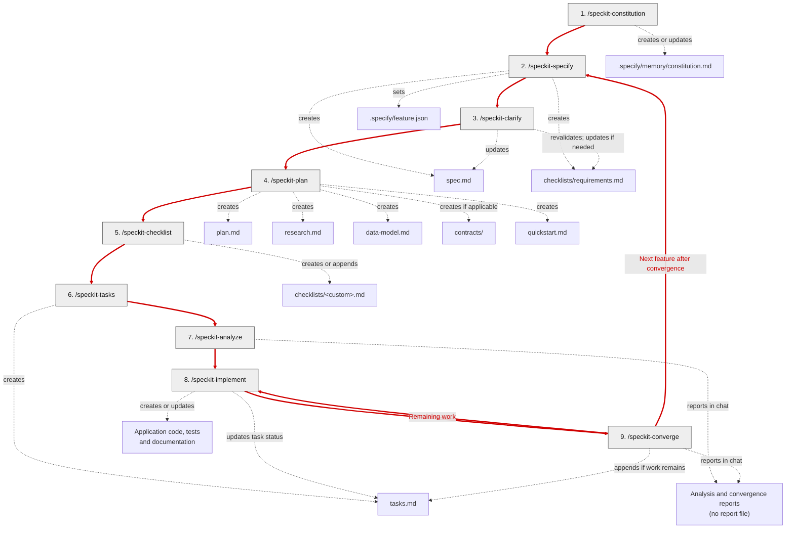

# Spec Kit Artifacts by Step

The diagram shows the expected workflow; it does not imply that every step has already been run. The constitution is established once for the project; the remaining steps repeat for each feature. Light-gray boxes identify the steps, and thick red arrows show the sequence. Dotted arrows show which step creates or updates each artifact, or produces a report; they do not show read-only inputs. Each artifact appears only once.

Except for the shared constitution and local active-feature pointer, these artifacts belong to the feature directory. `checklists/requirements.md` is maintained by `/speckit-specify` and `/speckit-clarify`; custom checklists from `/speckit-checklist` are reviewed by the user. For the FIT feature, clarification questions were answered during `specify` and `plan`, without a separate `clarify` invocation.

See the [Spec Kit usage guide](./spec-kit_use-guide.md) for details about each step.
